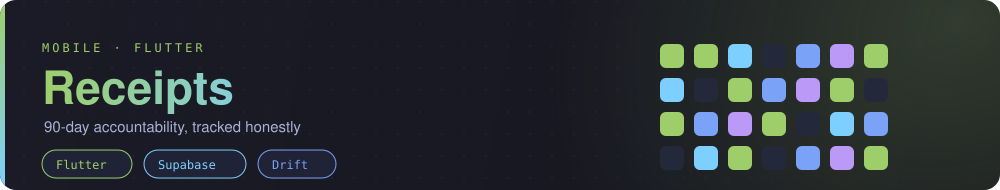

  

I'm a computer science student and independent developer. I build full-stack products and spend most of my time on the difficult parts — real-time synchronization, AI streaming and memory, and the engineering decisions that make a system stay reliable under load and failure.

- **What I build** — full-stack products, real-time applications, and AI systems.
- **How I think** — architecture, debugging, reliability, and the trade-offs behind each decision.
- **How I grow** — algorithms in C++, Python, and clearer technical communication for engineering interviews.

---

## Featured Projects

### WebChat — Real-time social communication platform

WebChat brings persistent messaging, multi-channel communities, voice and video, a social feed, and ephemeral stories into a single product — with an embedded AI assistant layered into the communication experience.

- **Distributed event delivery** — a Redis Pub/Sub adapter keeps Socket.IO events synchronized across multiple server instances, so presence and messages stay consistent as the app scales beyond one process.
- **Voice and video** — LiveKit provides the infrastructure for multi-party WebRTC rooms.
- **Auth** — JWT access and refresh-token flows handle session lifecycle.
- **Payload encryption** — browser-native Web Crypto APIs encrypt selected payloads on the client.
- **Containers** — Docker separates the application services from supporting infrastructure.
- **Native mobile** — the product also ships as an installable Android app via Capacitor.

**Stack:** `React` `TypeScript` `Node.js` `MongoDB` `Redis` `Socket.IO` `LiveKit` `Docker` `Tailwind CSS` `Capacitor`

**Links:** [Live app](https://webchat.qzz.io) · [System design & docs](https://github.com/Aashutosh31/webchat-system-design) · [Android APK](https://github.com/Aashutosh31/webchat-system-design/releases/download/v1.0.0/webchat.apk)

### ARC-AI — Streaming AI agent runtime

ARC-AI is an AI workspace built around progressive streaming, multi-step tool execution, conversational voice, live vision, and retrieval-based memory — with a provider-agnostic model router.

- **Incremental streaming** — responses arrive token by token over Socket.IO instead of waiting for a full completion, with persistence handled off the critical path.
- **Multi-step tool execution** — the agent invokes tools, reads their results, and continues, through a provider-independent tool registry.
- **Retrieval-based memory** — relevant historical context is retrieved on demand rather than resending the entire conversation each turn.
- **Interruptible voice** — a half-duplex voice state machine handles turn-taking and user barge-in.
- **Provider resilience** — a capability-aware router (Groq for text/tools, Gemini for multimodal) excludes providers that cannot serve a request and falls back cleanly, including mid-stream.
- **Sandboxed execution** — LLM-triggered code runs inside an ECMAScript (QuickJS/WASM) sandbox.

**Stack:** `React` `Node.js` `MongoDB` `Socket.IO` `LLM APIs` `RAG` `Pinecone` `STT/TTS`

**Links:** [Live demo](https://arc-ai-project.vercel.app/) · [Source code](https://github.com/Aashutosh31/arc-ai-project)

---

## Other Projects

### Receipts — 90-day accountability

A native Flutter app that tracks consistency over a 90-day commitment, built around an honest, local-first record of daily progress.

- **Offline-first** — a local Drift (SQLite) database keeps the app usable without connectivity and syncs with the backend.
- **Supabase backend** — authentication, Postgres data, and row-level security policies define exactly who can read and write what.
- **Native polish** — local notifications, timezone-aware scheduling, and a Riverpod-managed state layer.

**Stack:** `Flutter` `Dart` `Supabase` `PostgreSQL` `Drift` `Riverpod`

**Links:** [Website](https://aashutosh31.github.io/receipts/) · [Source code](https://github.com/Aashutosh31/receipts-app) · [Download APK](https://github.com/Aashutosh31/receipts-app/releases/download/v1.0.0/receipts-v1.0.0.apk)

### AttendTrack — Role-based college attendance

An attendance platform for colleges with separate dashboards for admins, HODs, faculty, coordinators, and students.

- **Role-based access** — a shared auth layer and role gates drive distinct dashboards and workflows per user type.
- **Face-recognition check-in** — face descriptors are enrolled and matched server-side with `face-api.js` on TensorFlow.js (WASM).
- **Auth sync** — Supabase handles identity while the backend verifies tokens and enforces authorization.

**Stack:** `React` `Vite` `Tailwind CSS` `Node.js` `Express` `MongoDB` `Supabase` `TensorFlow.js`

**Links:** [Live app](https://smart-attendance-frontend-seven.vercel.app) · [Backend source](https://github.com/Aashutosh31/smart-attendance-backend) · [Frontend source](https://github.com/Aashutosh31/smart-attendance-frontend)

### SIH Intelligence — Hackathon problem analyzer

Paste a Smart India Hackathon problem statement and it returns a structured execution plan: engineering interpretation, a difficulty and risk scorecard, a recommended stack, team-fit scoring, and task allocation.

- **AI where it helps** — Gemini interprets the problem statement into structured data.
- **Deterministic where it matters** — scoring, team-fit, and task allocation are application-owned logic, not model guesswork, so results stay explainable.

**Stack:** `React` `Vite` `Tailwind CSS` `Node.js` `Express` `MongoDB` `Gemini API`

**Links:** [Live app](https://sih-intelligent-problem-analyzer.vercel.app) · [Source code](https://github.com/Aashutosh31/SIH-Intelligent-Problem-Analyzer)

> **Also exploring — Sahaay (SIH26093).** A voice-first, multilingual triage prototype for a public helpline: AI extracts evidence-backed signals, but a fixed-weight engine computes the Stress & Vulnerability Index and every routing decision stays human-in-the-loop. A hackathon prototype, kept private for now.

---

## How I Engineer

The details I care about are the ones that show up when something goes wrong:

- **Design for failure, not just the happy path.** Streaming continues while a failed model call is retried or rerouted; voice recovers when a provider drops out mid-stream.
- **Separate concerns behind interfaces.** A provider-agnostic LLM router, a tool registry, and Docker service boundaries mean one component can change without rewriting the others.
- **Keep the critical path fast.** Streaming responses don't wait on persistence; retrieval fetches only the relevant context instead of the full history.
- **Keep humans in the loop for high-stakes decisions.** In the SIH triage work, the model extracts signals but deterministic, auditable logic produces the score.
- **Make state consistent.** Pub/Sub fan-out across Socket.IO instances and role-scoped access rules keep a distributed system behaving like one.

## Tech Stack

**Languages** — TypeScript · JavaScript · C++ · Dart · Python · Rust (learning)

**Frontend** — React · Vite · Tailwind CSS · Zustand · React Router · Framer Motion

**Mobile** — Flutter · Capacitor · Android

**Backend** — Node.js · Express · Socket.IO · REST APIs · JWT · Zod

**Data & AI** — MongoDB · Redis · Pinecone · Supabase (Postgres) · Drift · LLM APIs (Groq, Gemini) · RAG · Vector search · STT/TTS

**Real-time & Media** — WebSockets · WebRTC · LiveKit · Redis Pub/Sub · Streaming pipelines

**Infrastructure & Tools** — Docker · Docker Compose · Nginx · Git & GitHub · Vercel · Render · Linux (Arch, Hyprland)

## Currently Working On

- Improving WebChat's real-time communication and community experience.
- Refining ARC-AI's voice interaction, tool execution, and runtime reliability.
- Practising data structures and algorithms in **C++** with documented notes, alongside learning **Python**.
- Strengthening how I explain approaches, analyze complexity, debug problems, and communicate technical ideas.

### Beyond Building Projects

I'm deliberately working on three complementary areas:

1. **Building production-style projects** and understanding the real engineering trade-offs behind them.
2. **Practising algorithms and problem-solving** to get stronger for technical interviews.
3. **Improving technical communication** — presenting projects, explaining decisions, and reasoning through unfamiliar problems.

---

## GitHub Activity

## Connect

- **Portfolio:** [aashutoshbairagi.vercel.app](https://aashutoshbairagi.vercel.app/)
- **GitHub:** [github.com/Aashutosh31](https://github.com/Aashutosh31)
- **LinkedIn:** [Aashutosh Bairagi](https://www.linkedin.com/in/aashutosh-bairagi-559aa530b/)
- **X:** [@Aashutosh_dev31](https://x.com/Aashutosh_dev31)

  

